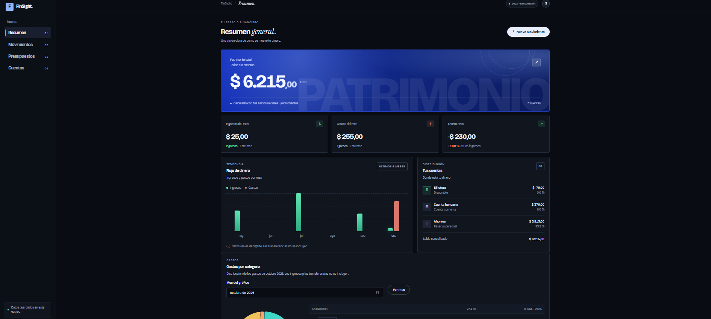
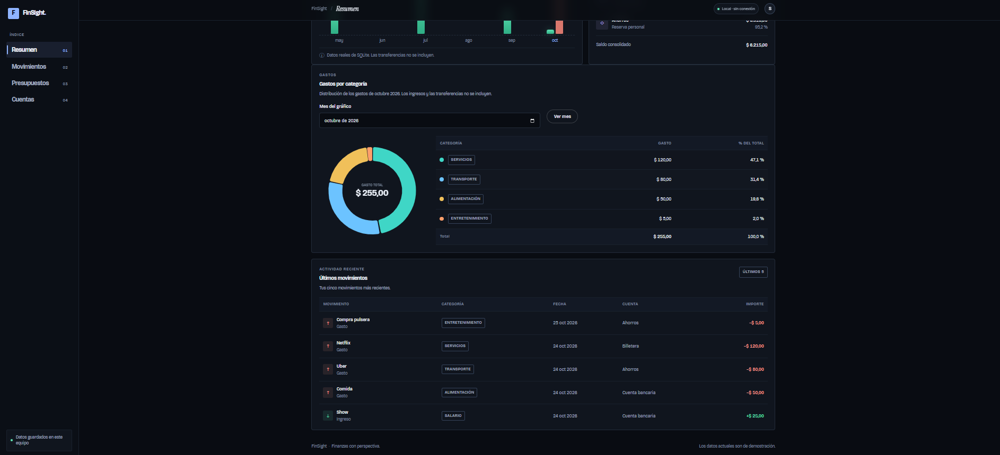
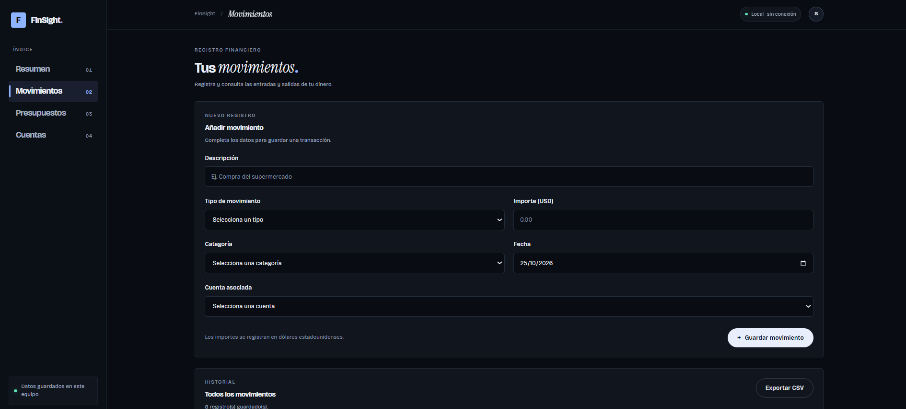
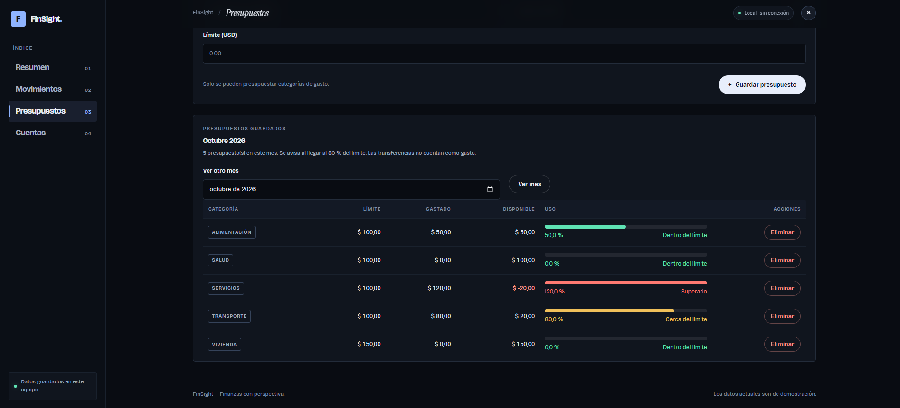
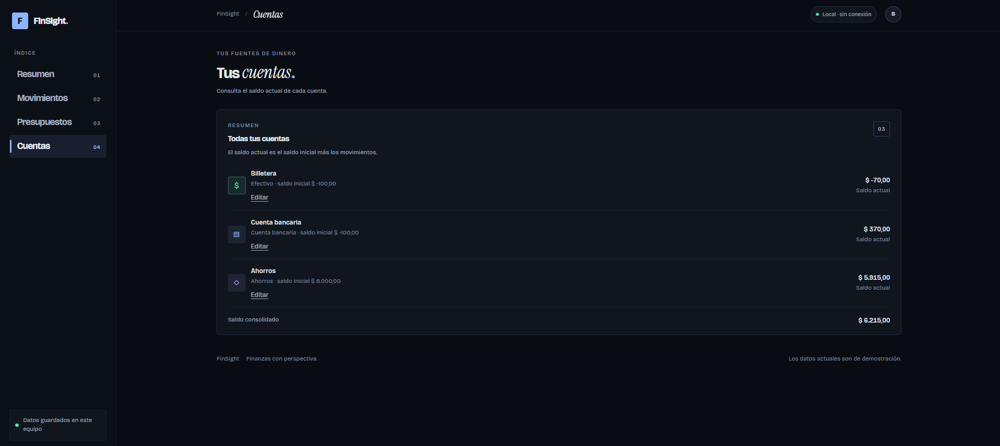

# FinSight

**FinSight** es una aplicación web local de finanzas personales desarrollada con Python, Flask y SQLite. Permite consultar el estado de las cuentas, registrar movimientos, analizar ingresos y gastos y gestionar presupuestos mensuales desde una interfaz moderna.

El proyecto tiene dos objetivos: construir una herramienta práctica y visualmente cuidada, y aprender buenas prácticas de desarrollo de software mediante Git, GitHub, ramas, commits, Issues, Pull Requests, pruebas automáticas y documentación.

> **Aviso:** FinSight es un proyecto personal de aprendizaje. Utiliza datos ficticios para demostración. No introduzcas información bancaria ni datos financieros sensibles reales.

## Funcionalidades

### Resumen financiero

- Visualizar el patrimonio total y el saldo actual de cada cuenta.
- Consultar los ingresos, gastos y ahorro neto del mes actual.
- Revisar la evolución de los ingresos y gastos durante los últimos seis meses.
- Analizar la distribución de los gastos por categoría y seleccionar el mes que se desea consultar.
- Consultar los cinco movimientos más recientes.
- Identificar visualmente los valores positivos y negativos.

### Movimientos

- Registrar ingresos y gastos con descripción, importe, categoría, fecha y cuenta.
- Editar y eliminar movimientos con confirmación.
- Buscar movimientos por descripción.
- Filtrar por tipo, categoría, cuenta y rango de fechas.
- Ordenar los resultados por diferentes columnas.
- Exportar los movimientos a CSV, respetando los filtros activos.
- Validar los datos en el servidor, incluidos los importes, las fechas, las categorías y las cuentas existentes.

Los importes deben ser mayores que cero y no superar los USD 1.000.000.000. Se redondean a dos decimales.

El CSV se genera en UTF-8 y utiliza comas como separadores. Para abrirlo correctamente en Excel con configuración regional en español, utiliza **Datos → Desde texto/CSV** si Excel no reconoce automáticamente las columnas.

### Cuentas

- Consultar las cuentas disponibles y sus saldos actuales.
- Visualizar el saldo inicial y el saldo calculado a partir de los movimientos.
- Editar el nombre, el tipo y el saldo inicial de una cuenta.
- Representar saldos iniciales negativos para reflejar deudas.

El saldo actual se calcula a partir del saldo inicial, los ingresos, los gastos y las transferencias registradas en la base de datos.

### Presupuestos

- Definir límites mensuales de gasto por categoría.
- Consultar el importe presupuestado, lo gastado, el saldo disponible y el porcentaje utilizado.
- Identificar visualmente los presupuestos próximos al límite, a partir del 80 %, y los que alcanzan o superan el 100 %.
- Actualizar un presupuesto existente para la misma categoría y mes.
- Eliminar presupuestos.

Las transferencias entre cuentas no se consideran ingresos ni gastos para los cálculos financieros.

## Capturas de pantalla

### 1. Página de resumen



### 2. Dashboard



### 3. Movimientos



### 4. Presupuestos



### 5. Cuentas



## Tecnologías

- **Python 3.11:** lógica de la aplicación, validaciones y cálculos.
- **Flask:** framework web.
- **SQLite:** base de datos relacional local.
- **HTML y CSS:** estructura y diseño de la interfaz.
- **Jinja2:** generación de páginas HTML mediante plantillas.
- **pytest:** pruebas automatizadas.
- **Git y GitHub:** control de versiones y colaboración.
- **GitHub Actions:** ejecución automática de las pruebas.

## Requisitos

- Windows, probado con PowerShell y Visual Studio Code.
- Python 3.11 o superior.
- Git.
- Un navegador web moderno.

## Instalación y ejecución

### 1. Clonar el repositorio

```powershell
git clone https://github.com/sebasarellano/FinSight.git
cd FinSight
```

### 2. Crear y activar un entorno virtual

```powershell
python -m venv .venv
.\.venv\Scripts\Activate.ps1
```

Si PowerShell impide activar el entorno por la política de ejecución de scripts, puedes permitir scripts locales para tu usuario:

```powershell
Set-ExecutionPolicy -Scope CurrentUser -ExecutionPolicy RemoteSigned
.\.venv\Scripts\Activate.ps1
```

Como alternativa, puedes utilizar el Símbolo del sistema (CMD):

```bat
.venv\Scripts\activate.bat
```

Cuando el entorno esté activo, aparecerá `(.venv)` al inicio de la línea de la terminal.

### 3. Instalar las dependencias

```powershell
python -m pip install -r requirements.txt
```

### 4. Ejecutar FinSight

```powershell
python app.py
```

Abre la siguiente dirección en el navegador:

<http://127.0.0.1:5000>

Para detener el servidor, vuelve a la terminal y pulsa `Ctrl + C`.

En la primera ejecución, FinSight crea automáticamente la carpeta `instance/`, la base de datos y las cuentas de ejemplo.

> `python app.py` inicia el servidor de desarrollo de Flask con el modo de depuración activado. Está destinado al desarrollo y al uso local; no debe exponerse a internet ni a una red compartida.

## Pruebas automáticas

Para ejecutar las pruebas con el entorno virtual activado:

```powershell
python -m pytest -v
```

Las pruebas cubren funcionalidades como el registro y la validación de movimientos, los cálculos de saldos y la gestión de presupuestos.

Se utiliza una base de datos temporal para las pruebas, de modo que no se modifiquen los datos locales de la aplicación.

GitHub Actions ejecuta las pruebas en cada Pull Request y en cada cambio enviado a `main`.

## Estructura del proyecto

```text
FinSight/
├── app.py
├── database.py
├── requirements.txt
├── pytest.ini
├── README.md
├── LICENSE
├── .gitignore
├── .github/
│   └── workflows/
│       └── tests.yml
├── docs/
│   └── screenshots/
│       ├── screenshot1.png
│       ├── screentshot2.png
│       ├── screenshot3.png
│       ├── screenshot4.png
│       └── screenshot5.png
├── templates/
│   ├── base.html
│   ├── dashboard.html
│   ├── transactions.html
│   ├── edit_transaction.html
│   ├── accounts.html
│   ├── edit_account.html
│   └── budgets.html
├── static/
│   └── css/
│       └── styles.css
└── tests/
    ├── conftest.py
    ├── test_transactions.py
    └── test_budgets.py
```

La carpeta `instance/` se genera localmente al ejecutar la aplicación y no se incluye en el repositorio.

## Limitaciones conocidas

FinSight es una aplicación de aprendizaje y no un sistema de contabilidad profesional.

- **Uso individual:** no incluye autenticación ni gestión de usuarios.
- **Seguridad web:** los formularios no cuentan con protección CSRF. No debe exponerse la aplicación a internet ni a redes compartidas.
- **Gestión de cuentas:** actualmente se pueden consultar y editar cuentas, pero no crearlas ni eliminarlas desde la interfaz.
- **Transferencias:** la base de datos contempla transferencias entre cuentas, pero todavía no se pueden crear desde la interfaz.
- **Importación CSV:** está disponible la exportación, pero no la importación de movimientos desde archivos CSV.
- **Migraciones:** no existe un sistema de migraciones del esquema de la base de datos. Los cambios futuros podrían requerir recrear la base local.
- **Precisión financiera:** los importes se almacenan como números de punto flotante. Es adecuado para el propósito educativo del proyecto, pero no para contabilidad formal.
- **Búsqueda con tildes:** la búsqueda de texto utiliza las capacidades de SQLite y puede distinguir entre determinadas letras con y sin tilde, según su combinación de mayúsculas y minúsculas.

## Datos locales y seguridad

La aplicación almacena sus datos en el equipo donde se ejecuta.

- La base de datos se encuentra en `instance/finsight.db`.
- La clave secreta de Flask se genera aleatoriamente y se guarda en `instance/secret_key`.
- Ambos archivos están excluidos del control de versiones mediante `.gitignore`.
- No se deben subir bases de datos personales, claves secretas ni otros datos sensibles al repositorio.

Añadir un archivo a `.gitignore` no elimina las versiones que ya se hayan enviado a GitHub. Si un dato sensible llega a publicarse, debe tratarse como comprometido y reemplazarse cuando corresponda.

## Objetivo de aprendizaje

FinSight también funciona como un proyecto práctico para aprender a mantener un repositorio profesional mediante:

- Desarrollo organizado en ramas.
- Commits con mensajes descriptivos.
- Seguimiento del trabajo con Issues.
- Integración de cambios mediante Pull Requests.
- Pruebas automatizadas con pytest y GitHub Actions.
- Documentación del proyecto y registro de cambios.

## Licencia

Este proyecto se distribuye bajo la licencia MIT. Consulta el archivo [LICENSE](LICENSE) para conocer sus condiciones.

## Autor

**Sebastián Arellano**

Proyecto personal de aprendizaje y desarrollo de software.

